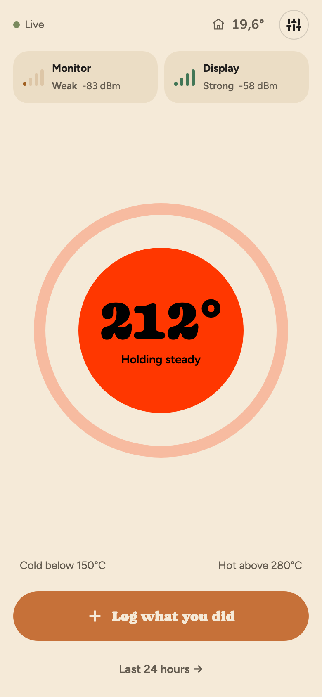
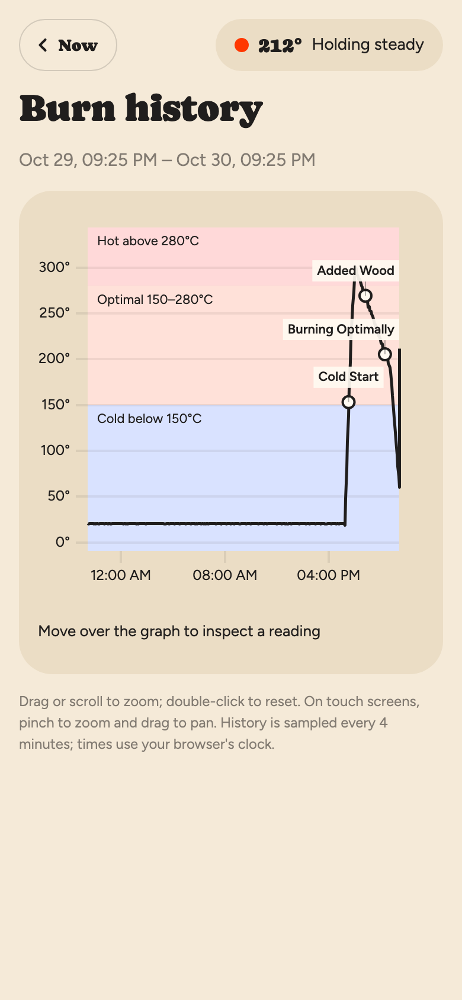
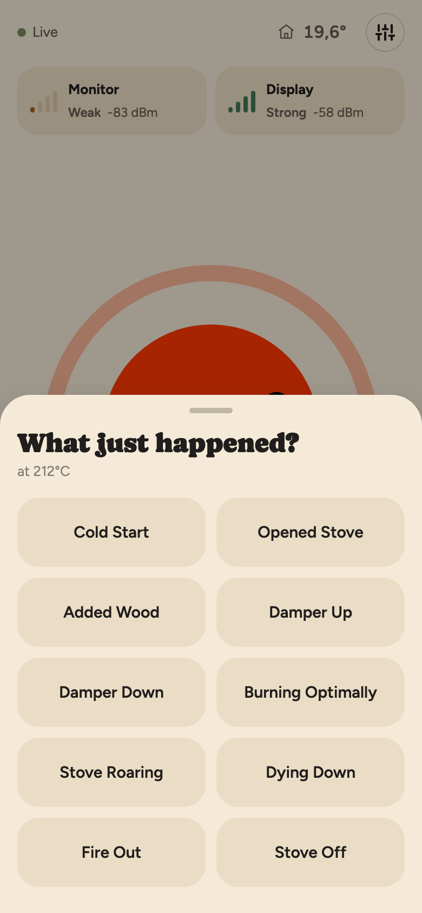

# Flue Monitor (project)

A DIY wood stove flue temperature monitor, made of two separate firmwares.
See `CLAUDE.md` for the full project goal and architecture.

- **[`flue-monitor/`](flue-monitor/)** — plain ESP-IDF sidecar that reads the
  stovepipe thermocouple and logs it. See `flue-monitor/README.md`.
- **[`flue-display/`](flue-display/)** — plain ESP-IDF ambient light display
  that polls the sidecar and shows the reading as a color/pulse gradient.
  See `flue-display/README.md`.

## Screenshots

The monitor serves a mobile-friendly web UI for checking the temperature,
exploring the last 24 hours and logging stove events. These screenshots use
the local demo server with simulated readings and events.

| Dashboard | Burn history | Stove events |
| --- | --- | --- |
|  |  |  |
